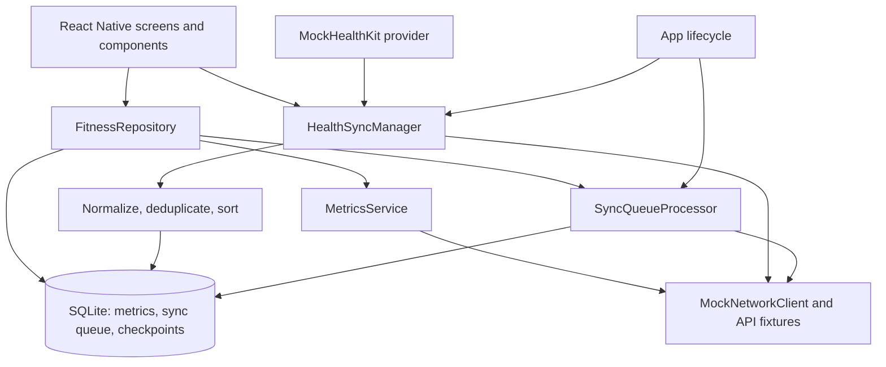

# Health Progress Tracker

A React Native health dashboard assignment focused on local-first data handling, manual weight logging, health-provider ingestion, and retryable synchronization. The backend and Apple Health provider are simulated; this repository does not contain a production service or native HealthKit bridge.

## Run the app

Requirements: Node.js `>=22.11.0`, Xcode and CocoaPods for iOS, or Android Studio and an Android SDK for Android.

```sh
npm install
npm start
```

In a second terminal, launch a platform:

```sh
npm run ios
# or
npm run android
```

For a fresh iOS checkout, install native dependencies first with `cd ios && pod install && cd ..`.

## Architecture



### Data and state

- Screens use local React state for view state. `FitnessRepository` is the boundary for metric reads and manual writes; SQLite is the durable source for locally recorded and imported measurements.
- `react-native-mmkv` stores small synchronous preferences and user settings. `react-native-nitro-sqlite` stores metric history, sync queue entries, schema versions, and provider checkpoints.
- Dashboard reads query local aggregates first. Mock API refreshes seed or refresh cached data. Empty metrics display as unavailable instead of inventing a reading.
- The dashboard uses a scroll view because it renders a fixed set of metric cards. Metric history queries are date-bounded; individual database queries accept `limit` and `offset`. The history chart scrolls horizontally and labels dates at month boundaries.

### Health provider boundary

`MockHealthKit` implements the provider API used by `HealthSyncManager`. The adapter maps provider metric identifiers to the app's `MetricType` values; normalized samples then pass through `normalizeHealthSamples` and persist as `FitnessMetricEntity` values. The normalizer standardizes supported weight and water units, timestamps, and record fields. Stable source identifiers and a deterministic sample hash support deduplication. Replacing the mock requires implementing the same permission, query, connection, and subscription behaviors for a native HealthKit or Health Connect adapter. Permission denial and bridge unavailability should be represented as provider errors and surfaced to the user.

### Offline writes and synchronization

Weight create, update, and delete operations update SQLite and the durable queue in one transaction. Repeated unsent updates or deletes for the same measurement are coalesced to their latest payload; distinct operations such as create then update remain ordered so the backend sees the same intent sequence. Requests use the queue item ID as an idempotency key and retain failure details for a manual retry. The processor recovers items left in `syncing` after a process restart. It is kicked on startup, app foreground, screen entry, and after local writes, and drains newly enqueued work after an in-flight batch.

The health import cursor advances only after its batch upload succeeds. If an upload fails after local persistence, the next import reads the same range and the local upsert deduplicates it. For competing data, the repository prevents older `updated_at` values from replacing newer rows; this is a client-side timestamp policy, not a distributed conflict protocol.

### Lifecycle and production scaling

The app retries queued work at startup and when returning to the foreground. SQLite preserves pending work across termination. The mock client simulates latency and retryable/non-retryable failures. This exercise does not implement OS-scheduled background transfer, actual connectivity monitoring, auth/session refresh, multi-device conflict resolution, or server-side idempotency and version checks. A production version should add a connectivity-aware scheduler, server-enforced idempotency/versioning, paginated history APIs, virtualized long lists, chart downsampling, and background task integration appropriate to each platform.

## Tests and quality commands

The Jest suite covers repositories and database behavior, offline queue processing, health normalization and sync, service behavior, and UI screens/components.

```sh
npm test
npm run typecheck
npm run lint
npm run format:check
```

## Trade-offs and limitations

- Health data and backend responses are fixtures/mocks. They demonstrate boundaries and failure paths but do not prove native permissions, real API behavior, or server consistency.
- The sync queue uses bounded retry counts and user-triggered retry; it does not yet persist a scheduled exponential backoff time or distinguish permanent errors in its UI.
- Dashboard and goal calculations are intentionally small and run on the JS thread. Larger datasets should aggregate in SQL or a background worker and page data into virtualized views.
- The target-weight goal is local preference data. It is not synchronized across devices.

## AI assistance

Codex was used to help write test cases, review the code for type safety, and implement parts of the local database and `HealthSyncManager`. I provided implementation direction and low-level assistance, reviewed the suggestions, and retained ownership of the final design and code. Codex also helped develop the high-level design (HLD) and low-level design (LLD). To maintain design and code consistency for AI I created some skills so that code is upto the mark. I added skills like testing, code-quality and theme usage to maintain code and design principles. I took help of codex and anti-gravity for this assignment
